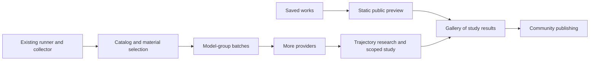

# Offcut roadmap

**Current status — October 2, 2026:** Offcut has a Library, a New run page with a fixed creative task, and read-only Work pages. The OpenAI runner saves isolated runs with frozen sources, native image observations, append-only events, limits, stop, export and recovery. Work pages provide accepted-action playback, speed controls, GIF export, brief fragment outlines, source/fragment inspection, and explicitly attributed model writing. Physical trimming now preserves retained pieces, usable offcuts, holes and lineage. Three early works are included as truthful archives. See [the component map](docs/PRODUCT.md) and [model interface](docs/MODEL_INTERFACE.md).

The **materials picker** is merged, the local collection has expanded, and **model-group batches** are implemented on this branch. Batches support independent draws in Explore, matching draws in Compare models, and an exact review of every planned table before launch. See [batch behavior and limits](docs/BATCHES.md). Curated study sets and a small static public gallery are next priorities, followed by additional providers and trajectory research. Hosted open models, community features and learned embeddings remain later work. The public gallery has not been deployed.

Originally drafted September 27, 2026; the sequence below is updated for the current implementation. It proposes implementation order, not a calendar commitment or authorization for a paid run campaign. Hosting, repository visibility and dollar spending controls remain implementation decisions; current runs expose request/action/time bounds and explicitly unavailable dollar estimates.

## Materials and run setup

The current starter pack contains 21 images. A bulk collection added 250 Cleveland Museum of Art images, bringing the local collected catalog to 262 and the combined picker to **283 images** as of October 2. Collected images remain local data rather than bundled Git assets. The initial volume target is met; deliberately balanced study packs still need curation. See [collection commands and provenance](docs/SOURCE_COLLECTION.md).

- **Separate catalog from active inventory.** Browse a growing disk-backed catalog through thumbnails, search and filters, loading only selected image bytes for a run. The shared studio inventory currently holds at most 24 images, and each run also accepts at most 24 images and 24 MiB of source data. A larger catalog should not require loading every image into that inventory or increasing the run limits.
- **Pin required materials and choose an additional random count.** Pinned images are always included in the run's materials. Allow zero additional images for manual-only selection and zero pins for random-only selection. Require at least one image overall and validate the final selection against count and byte limits. Inclusion supplies material to the artist; requiring every supplied image to appear in the artwork would be a separate experimental rule.
- **Make the random pool visible.** Choose the entire collection or current search/collection filters as eligible candidates. Draw without replacement, excluding pinned images. Reject an impossible requested count clearly. Reroll changes only the random portion and preserves every pin. Individual exclusions and reusable pool definitions remain later extensions.
- **Review and freeze the exact selection.** Show a contact sheet, attribution, pinned/random membership and the final count before launch. Launch uses those exact ordered source IDs, bytes and hashes; a retry keeps the reviewed draw. Record the selection recipe, seed, sampling algorithm/version and an immutable catalog/candidate-pool snapshot so the draw can be reconstructed after the library changes. The frozen images remain authoritative for replay.
- **Defer reusable named material sets.** First make one selection reliable and pleasant to review; saved material sets and pack management can build on the same frozen manifests later.

The picker now implements these core controls, with pagination, full-image attribution, selected-byte limits, draft restoration and launch-retry protection. Runs record candidate IDs/hashes alongside the catalog digest; selected files retain exact bytes and bounded provenance. The collector already provides duplicate detection, budgets and resume checkpoints. The bulk collection is complete. Next: curate experimental packs and refine the flow through real use. Batch validation uses simulated providers; no paid model campaign was run for this feature.

## Milestones and release gates

| Milestone | What ships | Completion criterion |
| --- | --- | --- |
| A. Public preview, in parallel | A short explanation, selected archived/recorded works, original source sheets, accepted-action replay, permanent artwork pages, and a methods note. | A visitor can understand the constraint, inspect a work, and watch its construction. Exploratory works retain their actual starting conditions and authoring labels. |
| B. Runner and material-selection foundation implemented | The OpenAI adapter, private key setup, isolated storage, bounded loop, catalog picker and sequential model-group batches are implemented. Explore and Compare models preserve reviewed source draws and per-run limits. | A run freezes the reviewed materials and reproducible selection recipe, then finishes or stops cleanly and exports a replayable bundle. |
| C. First public study | Several supported multimodal models, a repeated-run queue, blind review flow, a filterable gallery of study works, and a complete pilot report. | Every attempted study run is accounted for; published works link to their materials, protocol, replay, and results. The first public release does not wait for a universal creativity score. |
| D. Broader materials and open models | After the immediate catalog/picker milestone: more archive adapters, reusable pack management, Hugging Face routing, and a configurable compatible endpoint for self-hosted vision-language models. | A selected source pack is reproducible; an eligible hosted open model can complete the same action loop. Each route passes image-input and action-output checks. |
| E. Community creation and publication | Accounts, private drafts, validated project uploads, publishing controls, collections, shared challenges, and remix lineage. | A person can publish a collage and its available timeline with clear provenance, attribution, and authoring labels. Imported histories are distinguished from platform-recorded runs. |

Milestone A can begin from saved artifacts alongside the materials/setup work in B. Milestone C needs additional adapters and a frozen comparison protocol on top of the implemented batch queue and run records. Community publishing depends on a validated public artifact format. HF routing remains later scope.

## 1. Image library and experimental source packs

Curate deliberately varied packs from the expanded catalog: photography, botanical illustration, printed pages, maps, diagrams, textiles, isolated objects, and dense scenes. Add archives where those categories remain thin. The earlier proposal for 12 named, fixed packs of three images remains a later study-curation target, not an existing collection or a prerequisite for the first preview. Preserve the original botanical/city/space set as a legacy experimental pack when saved material sets are added.

Use two distinct objects:

- **Discovery library:** a growing searchable catalog. Search titles, subjects, institution, date, orientation, color, visual density, and rights. Cache thumbnails first; ingest full images when selected. Add semantic search after basic curation works.
- **Experiment pack:** an immutable, versioned manifest containing the exact cached image bytes used in a run. Store source IDs, object links, creators, item-level rights, retrieval date, original and normalized hashes, dimensions, and the normalization recipe.

The Cleveland Museum of Art CC0 collector is implemented. Possible additional integrations:

| Source | Role and eligibility rule |
| --- | --- |
| [The Met](https://metmuseum.github.io/) | Art, ornament, prints and textures. Use records marked `isPublicDomain` with an available image; preserve the object link and attribution. |
| [Smithsonian Open Access](https://www.si.edu/openaccess/faq) | Specimens, machines and cultural objects. Check the media's CC0 designation; open metadata alone does not establish image reuse eligibility. |
| [Library of Congress reuse collection](https://data.labs.loc.gov/free-to-use/) | Street scenes, maps, posters and ephemera, with downloadable metadata. Preserve each item's actual rights statement rather than relabeling every item CC0. |
| [Art Institute of Chicago](https://api.artic.edu/docs/) | Painting, print and design material. Filter for public-domain objects and preserve IIIF image identifiers and attribution. |
| [Biodiversity Heritage Library](https://about.biodiversitylibrary.org/tools-and-services/developer-and-data-tools/) | Botanical and animal illustrations and complete pages. Admit explicitly eligible image material; [metadata and image rights differ](https://about.biodiversitylibrary.org/help/copyright-and-reuse/). |

Private uploads and publicly redistributable source packs need separate publication eligibility. Offcut project exports embed source images, so publishing a project can redistribute original assets as well as the collage. Keep rights and attribution attached through ingestion, cutting, export, and publication.

For the first controlled study, choose packs before a run begins. Letting an agent search for its own images is a valuable later experimental condition, with its own search budget and recorded selection history.

## 2. Model access and API-key setup

Keep one action contract and implement thin provider adapters. OpenAI is implemented; Anthropic and Google are proposed additions after the materials/setup milestone. Required capabilities are image input and text/JSON action output; image generation is unnecessary. Support validated ordinary JSON where native tool calling or structured output is unavailable.

The local settings flow should offer provider selection, a private key entry or environment-variable connection, a connection test, eligible model selection, and a small image-input/action-output test. Keep credentials in the backend environment or an OS-backed credential store, outside the browser's persisted state, run logs, project exports, and repository. OpenAI's [quickstart](https://developers.openai.com/api/docs/quickstart) documents environment-based API-key setup.

Model records should include the actual provider/model identifier, resolved version when available, supported modalities, supplied configuration, image limits, and supported output formats. Do not silently send unsupported settings or drop images. Record provider-specific settings rather than pretending that a temperature, token limit, or reasoning setting means the same computation across providers.

Open-model access has two practical routes:

- **Hosted first:** Hugging Face [Inference Providers supports image-and-text input with text output](https://huggingface.co/docs/inference-providers/tasks/image-text-to-text). Its [catalog APIs](https://huggingface.co/docs/inference-providers/hub-api) distinguish available hosted models and expose provider information. A model existing on the Hub does not mean it is immediately available for inference. Pin the provider route during a study and record the resolved serving identity.
- **Self-hosted later:** accept a configured endpoint for a compatible server. [vLLM documents multimodal inputs through its compatible Chat Completions interface](https://docs.vllm.ai/en/latest/features/multimodal_inputs/). Image support depends on the selected model and serving configuration. Capture weights/revision, quantization and serving version when available. GPU deployment itself can remain outside the first Offcut release.

Validate each route with the same small fixture before it appears as selectable for a study. Record usage, elapsed time, failures, and cost when available; show unknown cost as unknown. Enforce request, action, turn, wall-time, and configured spending limits with reservations for in-flight requests and conservative cost estimates.

## 3. Experiment setup and run controls

The current observer product uses a fixed task, model/material/budget setup, batch review and read-only Work pages. Its implemented Explore and Compare models modes control how source draws are shared; neither allows human intervention during a run. The following remains a long-term experiment-workbench proposal. Editable creative prompts, intervention conditions and a live editable canvas require separately defined research scope.

Use a simple sequence: **Materials → Models → Rules → Review and run**.

The default form should expose:

- Source pack, with a contact sheet and attribution preview.
- Model or comparison group, using saved provider connections.
- Open-ended task prompt or a named, versioned study template.
- Number of independent repetitions, with total planned run count shown.
- Fragment/action limits, canvas preset, observation policy, and time/spend budget.
- A review screen summarizing what will be held constant and what will vary.

Put sampling settings, provider-specific compute controls, image sizing, coordinate aids, and batch size under advanced controls. Default to a fresh context and blank canvas for a controlled study. Human-seeded work is a separate, explicit condition.

Possible later authoring conditions, separate from the implemented batch sampling modes:

- **Assisted exploration:** flexible work, source changes and human intervention allowed and recorded.
- **Study:** frozen inputs, independent runs, fixed rules and observation policy. A human takeover produces a labeled intervention or a new branch of the work rather than silently changing the study condition.

The run view should show the live canvas, current state, attempted and accepted actions, remaining budget, estimated/reported usage, and clear stop/failure reasons. Add cancel, pause between turns, and recovery from a saved checkpoint. An interrupted network request must not silently duplicate a placement or restart the whole artwork. Start with one worker and expand concurrency after isolation and budget accounting work.

## 4. Run records and trajectory viewing

Define the run bundle before building a rich viewer. It should contain the frozen run specification, immutable source references, image observations, model requests and returned outputs, explicit short decision notes, attempted actions and responses, canvas checkpoints, termination reason, intervention history, and usage metadata. Link events by run, turn, observation and request identifiers; store repeated image bytes once by hash.

The append-only experiment record must survive undo, retries and abandoned continuations. The editable project's retained canvas history remains useful but is not the complete experiment record. Native internal reasoning is not a requirement; deliberate decision notes are a separate, visible output.

Accepted-action playback, action stepping/scrubbing, speed controls, fragment outlines, source/fragment inspection and GIF export are shipped. Extend that foundation in stages:

1. Existing accepted-action playback on the first public pages.
2. Turn-by-turn inspection showing the images made available to the agent, its note, the command batch, and the resulting canvas.
3. Synchronized source-cut highlighting, before/after detail, errors and revisions, and shareable links to an exact step.
4. Side-by-side runs with a clearly labeled alignment mode: model turn, action count, or normalized progress. Those alignments are not equivalent measures of effort.

Replaying recorded artwork should reconstruct it exactly. Repeating a model run may produce a different result even with the same requested settings; label those two operations distinctly.

## 5. Public gallery, filters and participation

The first public gallery can be generated from deliberately published run bundles while experiments and API keys remain private. Start with a static gallery manifest and stored artifacts; introduce account and submission databases when community publishing needs them. The gallery needs thumbnails, permanent work pages, source sheets, replay, concise statements, model/run metadata, and a clear link to methods. The three archived works and selected recorded runs can establish the format before a full study is available.

Prioritize filters for model/provider, source pack, experiment/condition, authoring mode (human, agent, mixed or unknown), date, fragment/action budget, and run status. Later add subject/style tags, cost range, collections, repeated motifs, and source institution. Distinguish curator/author tags from tags inferred by another model. Use all-runs or chronological views alongside selected highlights so a showcase does not masquerade as an unbiased sample.

High-value interactions:

- **Same materials:** view every published attempt using a particular pack.
- **Blind browse:** inspect images with model identity and narrative hidden.
- **Compare two works:** synchronized source sheets and optional timelines.
- **Continue from this step:** create a new work with a visible parent and handoff record.
- **Weekly shared pack:** a recurring community prompt that produces comparable galleries.
- **Share a short replay:** a timelapse or step link that leads back to the full record.

Community publication can follow the initial gallery. Add private drafts, accounts, upload of bounded project bundles, validated server rendering, a publication preview, source-rights fields, reporting/removal controls, and collection/profile pages. Prefer validated data bundles over accepting executable project code. Label an imported replay-valid project differently from a run recorded by Offcut's runner; neither label should imply access to the author's internal reasoning.

Community likes are discovery signals. A separately assigned blind study is the route to research ratings. Hosted public model runs and a shared inference budget require quotas and job controls and are later scope; visitors do not need them to browse or upload eligible work.

## 6. Measurement and results worth publishing

The [representation research track](docs/REPRESENTATION_TRACK.md), accepted September 28, formalizes source use, construction, novelty and diversity, then tests whether provenance improves an embedding's agreement with human similarity judgments. It begins with frozen encoders and interpretable descriptors; a learned space follows only if the data supports it.

Keep four views of the result separate:

| View | Candidate measures | What it tells us |
| --- | --- | --- |
| Validity | Source provenance, allowed operations, geometry, budget compliance, exact replay | Whether the task was completed under its rules |
| Process | Success/failure, attempted actions, revisions, observations, source use, runtime and cost | How the work was produced; more actions do not automatically mean more creativity |
| Audience response | Blinded visual coherence/appeal, surprise, reinterpretation of source material, optional pairwise preference | How the recruited viewers respond under defined viewing conditions |
| Diversity | Repeated motifs, composition families, source-region choices, variation within and between models | Whether repeated runs explore different possibilities |

The first research question should be: **When agents receive the same scraps, how much do their compositions converge?** The first two demos motivated this question; they did not answer it because their initial states differed and there were only two examples. Subsequent exploratory runs also do not constitute a controlled comparison.

Proposed sequence:

1. Eight development runs: two models × two packs × two repeats. Use these to debug the interface and estimate cost; exclude them from a later frozen comparison.
2. A possible exploratory pilot: three models × six packs × four fresh-context repeats = 72 works. Adjust the scope after the cost check. This is a proposed study size, not a power calculation or an authorized spending budget.
3. Approximately five independent reviews per work as an initial allocation, with identities hidden. Show artwork alone first; show sources in a separate section for reinterpretation ratings. Record rater experience and analyze variation across packs, runs and raters.
4. Release contact sheets of all attempts, replay links, a short illustrated report, study specifications, and uncertainty. Separate curated highlights from the complete study manifest.

Follow-up questions can test whether visual feedback changes the work, whether smaller fragment budgets help or hurt, how salient source objects steer the composition, whether an artist statement changes judgments, and how selection of a best run changes the apparent performance. A human reference round using the same materials and operations is also useful once the study workflow is stable.

The detailed [research plan](docs/RESEARCH_PLAN.md) defines these questions and their limitations. Rankings can come after enough reliable judgments; a single global creativity score is not an initial release requirement.

## Immediate implementation sequence

Updated October 2 after the material picker, bulk collection and batch implementation; this sequence does not authorize a paid experiment campaign. The detailed workbench and study designs above remain proposals, with the current observer interface taking precedence for near-term UI scope.

| Order | Work item | Evidence that it is done |
| --- | --- | --- |
| Implemented | Connect the catalog and pinned-plus-random picker | A catalog larger than 24 images is searchable and browsable; pins, count, filtered pool, random-only reroll and exact review work together. Launch freezes selected bytes, hashes, recipe, seed and candidate manifest. |
| Implemented | Expand the local image catalog | 250 new images bring the collected catalog to 262 and the combined picker to 283, with hashes, dimensions and attribution verified. |
| Implemented | Run model-group batches | Per-model counts, independent or matching draws, pinned extras, exact table review, sequential execution, stop and interruption records work together. |
| Next | Curate study packs and refine setup | Balanced selections retain provenance; individual pool exclusions and saved sets can follow observed needs. |
| Parallel | Publish a small static gallery preview | Deliberately selected archived/recorded works have permanent pages, source sheets, provenance and replay, with truthful exploratory labels. |
| 3 | Add provider routes | Additional image-capable providers use the same commands and recorded observation policy, with route-specific validation and usage records. |
| 4 | Develop trajectory research and a scoped pilot/report | Stated intentions are linked to observations/actions and independently assessed outcomes; every attempted run is accounted for and claims reflect the design's limits. Paid runs require a separately agreed scope and budget. |
| Later | Saved material sets, broader archives, HF/self-hosted routes, community publication and learned representations | Each extension has its own validated contract; learning a representation follows evidence from descriptive measures, frozen encoders and held-out human judgments. |

Keep the first public preview small. Accounts, social feeds, GPU hosting, semantic search and a headline leaderboard can follow a useful gallery and a reliable material-selection flow.
