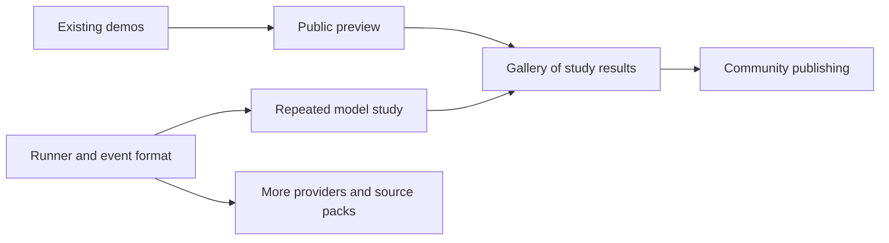

# Offcut roadmap

Drafted September 27, 2026. Priority agreed with the project owner: model experiments first, with a public presence as quickly as possible.

Build a reliable experimental workbench and let a small public gallery grow directly from its recorded runs. A first public preview can show the two existing demonstrations while the model runner is being built. Open community submissions and hosted model execution do not need to be prerequisites for that preview.

This is a proposed implementation sequence, not a calendar commitment. As of September 28, the studio, action API, replay, two exploratory collages, and the first OpenAI runner exist. The runner includes setup, private connection handling, isolated saved runs, observations/events, limits and stop controls. Additional providers, repeat queues, a public site and research evaluation remain. Hosting, repository visibility and dollar spending controls are still implementation decisions; the initial runner exposes hard request/action/time bounds and unavailable dollar estimates explicitly.

## Milestones and release gates

| Milestone | What ships | Completion criterion |
| --- | --- | --- |
| A. Public preview, in parallel | A short explanation, the two current demo works, original source sheets, accepted-action replay, permanent artwork pages, and a methods note. | A visitor can understand the constraint, inspect a work, and watch its construction. Both works are labeled exploratory demos with different starting conditions. |
| B. Reliable experiment runner | A provider adapter, private API-key setup, isolated run storage, fixed source packs, bounded model loop, complete event recording, and a simple experiment form. Add the other major-provider adapters after the first works end to end. | A run can start from a saved specification, finish or stop cleanly, and export a replayable bundle without an operator manually writing its commands. |
| C. First public study | Several supported multimodal models, a repeated-run queue, blind review flow, a filterable gallery of study works, and a complete pilot report. | Every attempted study run is accounted for; published works link to their materials, protocol, replay, and results. The first public release does not wait for a universal creativity score. |
| D. More materials and open models | Archive search and ingestion, a larger curated catalog, pack creation, Hugging Face routing, and a configurable compatible endpoint for self-hosted vision-language models. | A selected source pack is reproducible; an eligible hosted open model can complete the same action loop. Each route passes image-input and action-output checks. |
| E. Community creation and publication | Accounts, private drafts, validated project uploads, publishing controls, collections, shared challenges, and remix lineage. | A person can publish a collage and its available timeline with clear provenance, attribution, and authoring labels. Imported histories are distinguished from platform-recorded runs. |

Milestone A can begin immediately from saved artifacts. Milestone C depends on B's reliable run records. Work on the gallery's presentation can run alongside B; community publishing depends on a validated public artifact format. An HF connector can move earlier if an appropriate hosted model is already available and the adapter contract is stable.

## 1. Image library and experimental source packs

Start with roughly 120–200 deliberately varied images and 12 named, fixed packs of three images. These are proposed curation targets, not prerequisites for the first preview. Begin the runner with the existing pack and a few contrasting packs. Include photography, botanical illustration, printed pages, maps, diagrams, textiles, isolated objects, and dense scenes. Keep the current botanical/city/space set as a named legacy pack.

Use two distinct objects:

- **Discovery library:** a growing searchable catalog. Search titles, subjects, institution, date, orientation, color, visual density, and rights. Cache thumbnails first; ingest full images when selected. Add semantic search after basic curation works.
- **Experiment pack:** an immutable, versioned manifest containing the exact cached image bytes used in a run. Store source IDs, object links, creators, item-level rights, retrieval date, original and normalized hashes, dimensions, and the normalization recipe.

Useful initial integrations:

| Source | Role and eligibility rule |
| --- | --- |
| [The Met](https://metmuseum.github.io/) | Art, ornament, prints and textures. Use records marked `isPublicDomain` with an available image; preserve the object link and attribution. |
| [Smithsonian Open Access](https://www.si.edu/openaccess/faq) | Specimens, machines and cultural objects. Check the media's CC0 designation; open metadata alone does not establish image reuse eligibility. |
| [Library of Congress reuse collection](https://data.labs.loc.gov/free-to-use/) | Street scenes, maps, posters and ephemera, with downloadable metadata. Preserve each item's actual rights statement rather than relabeling every item CC0. |
| [Art Institute of Chicago](https://api.artic.edu/docs/) | Painting, print and design material. Filter for public-domain objects and preserve IIIF image identifiers and attribution. |
| [Biodiversity Heritage Library](https://about.biodiversitylibrary.org/tools-and-services/developer-and-data-tools/) | Botanical and animal illustrations and complete pages. Admit explicitly eligible image material; [metadata and image rights differ](https://about.biodiversitylibrary.org/help/copyright-and-reuse/). |

Private uploads and publicly redistributable source packs need separate publication eligibility. Offcut project exports embed source images, so publishing a project can redistribute original assets as well as the collage. Keep rights and attribution attached through ingestion, cutting, export, and publication.

For the first controlled study, choose packs before a run begins. Letting an agent search for its own images is a valuable later experimental condition, with its own search budget and recorded selection history.

## 2. Model access and API-key setup

Keep one action contract and implement thin provider adapters. Build the first adapter for a provider the owner can access, validate the full loop, then complete support for OpenAI, Anthropic, and Google. Required capabilities are image input and text/JSON action output; image generation is unnecessary. Support validated ordinary JSON where native tool calling or structured output is unavailable.

The local settings flow should offer provider selection, a private key entry or environment-variable connection, a connection test, eligible model selection, and a small image-input/action-output test. Keep credentials in the backend environment or an OS-backed credential store, outside the browser's persisted state, run logs, project exports, and repository. OpenAI's [quickstart](https://developers.openai.com/api/docs/quickstart) documents environment-based API-key setup.

Model records should include the actual provider/model identifier, resolved version when available, supported modalities, supplied configuration, image limits, and supported output formats. Do not silently send unsupported settings or drop images. Record provider-specific settings rather than pretending that a temperature, token limit, or reasoning setting means the same computation across providers.

Open-model access has two practical routes:

- **Hosted first:** Hugging Face [Inference Providers supports image-and-text input with text output](https://huggingface.co/docs/inference-providers/tasks/image-text-to-text). Its [catalog APIs](https://huggingface.co/docs/inference-providers/hub-api) distinguish available hosted models and expose provider information. A model existing on the Hub does not mean it is immediately available for inference. Pin the provider route during a study and record the resolved serving identity.
- **Self-hosted later:** accept a configured endpoint for a compatible server. [vLLM documents multimodal inputs through its compatible Chat Completions interface](https://docs.vllm.ai/en/latest/features/multimodal_inputs/). Image support depends on the selected model and serving configuration. Capture weights/revision, quantization and serving version when available. GPU deployment itself can remain outside the first Offcut release.

Validate each route with the same small fixture before it appears as selectable for a study. Record usage, elapsed time, failures, and cost when available; show unknown cost as unknown. Enforce request, action, turn, wall-time, and configured spending limits with reservations for in-flight requests and conservative cost estimates.

## 3. Experiment setup and run controls

Use a simple sequence: **Materials → Models → Rules → Review and run**.

The default form should expose:

- Source pack, with a contact sheet and attribution preview.
- Model or comparison group, using saved provider connections.
- Open-ended task prompt or a named, versioned study template.
- Number of independent repetitions, with total planned run count shown.
- Fragment/action limits, canvas preset, observation policy, and time/spend budget.
- A review screen summarizing what will be held constant and what will vary.

Put sampling settings, provider-specific compute controls, image sizing, coordinate aids, and batch size under advanced controls. Default to a fresh context and blank canvas for a controlled study. Human-seeded work is a separate, explicit condition.

Provide two modes:

- **Explore:** flexible work, source changes and human intervention allowed and recorded.
- **Study:** frozen inputs, independent runs, fixed rules and observation policy. A human takeover produces a labeled intervention or a new branch of the work rather than silently changing the study condition.

The run view should show the live canvas, current state, attempted and accepted actions, remaining budget, estimated/reported usage, and clear stop/failure reasons. Add cancel, pause between turns, and recovery from a saved checkpoint. An interrupted network request must not silently duplicate a placement or restart the whole artwork. Start with one worker and expand concurrency after isolation and budget accounting work.

## 4. Run records and trajectory viewing

Define the run bundle before building a rich viewer. It should contain the frozen run specification, immutable source references, image observations, model requests and returned outputs, explicit short decision notes, attempted actions and responses, canvas checkpoints, termination reason, intervention history, and usage metadata. Link events by run, turn, observation and request identifiers; store repeated image bytes once by hash.

The append-only experiment record must survive undo, retries and abandoned continuations. The editable project's retained canvas history remains useful but is not the complete experiment record. Native internal reasoning is not a requirement; deliberate decision notes are a separate, visible output.

Extend the current replay in stages:

1. Existing accepted-action playback on the first public pages.
2. Turn-by-turn inspection showing the images made available to the agent, its note, the command batch, and the resulting canvas.
3. Source-cut highlighting, before/after view, errors and revisions, speed controls, and shareable links to an exact step.
4. Side-by-side runs with a clearly labeled alignment mode: model turn, action count, or normalized progress. Those alignments are not equivalent measures of effort.

Replaying recorded artwork should reconstruct it exactly. Repeating a model run may produce a different result even with the same requested settings; label those two operations distinctly.

## 5. Public gallery, filters and participation

The first public gallery can be generated from deliberately published run bundles while experiments and API keys remain private. Start with a static gallery manifest and stored artifacts; introduce account and submission databases when community publishing needs them. The gallery needs thumbnails, permanent work pages, source sheets, replay, concise statements, model/run metadata, and a clear link to methods. The current two works can establish the format before a full study is available.

Prioritize filters for model/provider, source pack, experiment/condition, authoring mode (human, agent, mixed or unknown), date, fragment/action budget, and run status. Later add subject/style tags, cost range, collections, repeated motifs, and source institution. Distinguish curator/author tags from tags inferred by another model. Use all-runs or chronological views alongside selected highlights so a showcase does not masquerade as an unbiased sample.

High-value interactions:

- **Same materials:** view every published attempt using a particular pack.
- **Blind browse:** inspect images with model identity and narrative hidden.
- **Compare two works:** synchronized source sheets and optional timelines.
- **Continue from this step:** create a new work with a visible parent and handoff record.
- **Weekly shared pack:** a recurring community prompt that produces comparable galleries.
- **Share a short replay:** a timelapse or step link that leads back to the full record.

Community publication can follow the initial gallery. Add private drafts, accounts, upload of bounded project bundles, validated server rendering, a publication preview, source-rights fields, reporting/removal controls, and collection/profile pages. Prefer validated data bundles over accepting executable project code. Label an imported replay-valid project differently from a run recorded by Offcut's runner; neither label should imply access to the author's internal reasoning.

Community likes are discovery signals. A separately assigned blind study is the route to research ratings. Hosted public model runs and a shared inference budget require quotas and job controls and are later scope; visitors do not need them to browse or upload eligible work.

## 6. Measurement and results worth publishing

The [representation research track](docs/REPRESENTATION_TRACK.md), accepted September 28, formalizes source use, construction, novelty and diversity, then tests whether provenance improves an embedding's agreement with human similarity judgments. It begins with frozen encoders and interpretable descriptors; a learned space follows only if the data supports it.

Keep four views of the result separate:

| View | Candidate measures | What it tells us |
| --- | --- | --- |
| Validity | Source provenance, allowed operations, geometry, budget compliance, exact replay | Whether the task was completed under its rules |
| Process | Success/failure, attempted actions, revisions, observations, source use, runtime and cost | How the work was produced; more actions do not automatically mean more creativity |
| Audience response | Blinded visual coherence/appeal, surprise, reinterpretation of source material, optional pairwise preference | How the recruited viewers respond under defined viewing conditions |
| Diversity | Repeated motifs, composition families, source-region choices, variation within and between models | Whether repeated runs explore different possibilities |

The first research question should be: **When agents receive the same scraps, how much do their compositions converge?** Our two demos motivate this question; they do not answer it because their initial states differed and there are only two examples.

Proposed sequence:

1. Eight development runs: two models × two packs × two repeats. Use these to debug the interface and estimate cost; exclude them from a later frozen comparison.
2. A possible exploratory pilot: three models × six packs × four fresh-context repeats = 72 works. Adjust the scope after the cost check. This is a proposed study size, not a power calculation or an authorized spending budget.
3. Approximately five independent reviews per work as an initial allocation, with identities hidden. Show artwork alone first; show sources in a separate section for reinterpretation ratings. Record rater experience and analyze variation across packs, runs and raters.
4. Release contact sheets of all attempts, replay links, a short illustrated report, study specifications, and uncertainty. Separate curated highlights from the complete study manifest.

Follow-up questions can test whether visual feedback changes the work, whether smaller fragment budgets help or hurt, how salient source objects steer the composition, whether an artist statement changes judgments, and how selection of a best run changes the apparent performance. A human reference round using the same materials and operations is also useful once the study workflow is stable.

The detailed [research plan](docs/RESEARCH_PLAN.md) defines these questions and their limitations. Rankings can come after enough reliable judgments; a single global creativity score is not an initial release requirement.

## Immediate implementation sequence

| Order | Work item | Evidence that it is done |
| --- | --- | --- |
| 1 | Run specification, event schema and isolated storage | A recorded fixture reconstructs exactly; failed attempts remain available; two runs cannot change each other's worktables. |
| 2 | First provider adapter and credential connection | A fresh model receives source/canvas images and completes a short constrained run; credentials never appear in its exports. |
| 3 | Experiment form, limits and recoverable execution | A person can launch, watch, stop, and inspect a saved run without writing a script. |
| 4 | Initial fixed packs and another model route | The same pack hashes and protocol are used across repeated runs; usage and failures are reported. |
| 5 | Public artifact page and gallery | Existing demos and selected recorded runs have permanent pages, provenance and replay; a complete study manifest is available when making comparative claims. |
| 6 | Pilot and first report | Every attempted run is accounted for and the report distinguishes observed effects, uncertainty and open questions. |

Public-preview presentation work in item 5 can start alongside items 1–3 using the existing demo exports. Keep the initial gallery small so accounts, social feeds, massive image ingestion, full GPU hosting, sophisticated semantic search, and a headline leaderboard do not delay the first public artifact.
