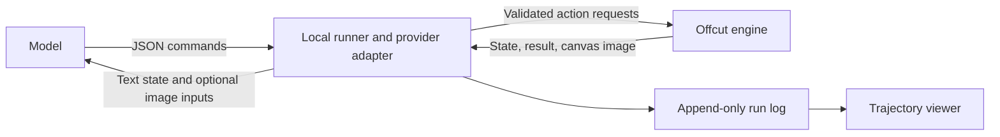

# Observation and action interfaces

Agreed scope, September 27, 2026: the first model comparison uses image-capable multimodal models, native image observations, and text/JSON action output. Models share source materials, initial canvas, observation policy, commands, and budget. Text-only assistance is deferred. The first OpenAI runner was implemented September 28; additional providers and controlled comparisons remain planned.

## What Experiment 001 actually used

The main Codex agent inspected the three source JPEGs with an image-viewing tool. After submitting action batches, it downloaded the rendered canvas from `GET /api/render.png` and inspected those PNG files through the same tool. The images arrived as image content alongside the conversation. This was direct image inspection, not screenshots of the laptop display. The image transport does not expose the model's precise internal visual tokenization or resolution handling.

Every artwork change went through JSON requests to `POST /api/actions`, submitted by a small local client. Source coordinates and placement coordinates came from the agent; the engine validated and applied them. The agent used browser automation only to confirm the finished title, canvas state, and replay controls in the app, and to keep the studio tab available. It did not click or drag artwork to create the composition.

The experiment used 48 agent actions in five batches after the owner's five initial actions. A separate agent audited the final artifacts; it did not author the artwork. The saved [trajectory](../experiments/001/trajectory.md) distinguishes the recorded action log from observations and commentary retained in the conversation.

## Implemented today

| Purpose | Interface | Contents |
| --- | --- | --- |
| Read available commands | `GET /api/help` | Action vocabulary and limits |
| Read state | `GET /api/state` | Canvas, rules, sources, pieces, transforms, layer order, budget and history; currently includes source data URLs |
| Inspect a source | `GET /api/sources/:id` | Source raster, normalized to PNG |
| Inspect canvas | `GET /api/render.png` | Clean rendering of the composition |
| Apply commands | `POST /api/actions` | One action or an atomic action batch |
| Inspect an earlier step | `GET /api/state?step=N`, `GET /api/render.png?step=N` | Reconstructed retained history without changing live state |
| Export project | `GET /api/project` | Source inventory, rules, canvas, timestamps, actions and cursor |

The action vocabulary is `cut`, `trim`, `place`, `transform`, `reorder`, `remove`, and `describe`. Cuts and trims use source-image pixel coordinates. Placement uses canvas pixels with the fragment bounding box's center as its anchor. Scale is uniform. Full details are in [AGENT_PROTOCOL.md](../AGENT_PROTOCOL.md).

`trim` takes `{type:"trim",pieceId,newPieceId,polygon}` and uses the polygon as a mask over a usable piece's actual material. The input mask follows the source-cut geometry rules but may cross the parent's boundary or holes. Intersecting it with the parent cannot add material. Empty or unchanged results are rejected. Each connected retained component becomes a child with the same visible placement and layer; each connected offcut becomes a usable hidden child in the tray. A later action may place or further trim an offcut.

The first retained child receives `newPieceId`; other retained children and all offcuts receive generated `piece-N` IDs. Each child records `parentPieceId` and `trimRole` (`retained` or `offcut`). The retired parent records `supersededBy` for its first retained child and `childPieceIds` for the full result. Models should inspect the new state before referring to generated IDs. A piece's `polygon` is its outer boundary, with optional `holes` containing absent source material. Holes are derived by the engine, not supplied in the action, and cannot be filled by trimming.

Each trim consumes one action. Fragment capacity counts usable pieces, including all hidden offcuts, and excludes retired parents. The whole trim is rejected if its complete result exceeds capacity. Generated output preserves small scraps and boundaries beyond the input minimum-area or vertex rules; a separate 8192-vertex limit across all output outer boundaries and holes rejects overly complex trims atomically. Source areas remain consumed: an offcut is reused through its child ID, never through a duplicate source cut.

For example, a model can request this existing action without using a mouse:

```json
{
  "type": "transform",
  "pieceId": "wing-upper-left",
  "x": 342,
  "y": 493,
  "rotation": 23,
  "scale": 0.96
}
```

The shared engine enforces simple input polygons, source boundaries, one-time material consumption, usable-piece/action limits, and transform bounds. The renderer clips source images to outer boundaries and holes and composites them into SVG and PNG. Observation and command execution are already separate.

## Integrated experiment runner

Open `/new.html` to configure a run. `lib/runs.mjs` owns isolated states, source snapshots, events and recovery; `lib/providers.mjs` translates native observations to the OpenAI Responses API. Credentials live in the backend environment or session memory. Tests inject simulated providers without paid requests.

| Interface | Purpose |
| --- | --- |
| `GET /api/providers` | Connection metadata, never credentials |
| `POST /api/providers/openai` | Set `{apiKey}` in server memory |
| `DELETE /api/providers/openai` | Forget the session override; an environment key may remain |
| `POST /api/providers/openai/test` | Check authentication through model listing, without inference |
| `GET /api/source-catalog` | Compact studio/collected metadata, source hashes, catalog digest and per-run limits |
| `GET /api/materials/:id`, `/thumbnail` | Read a catalog image or its bounded thumbnail without importing it into the studio |
| `GET /api/runs`, `POST /api/runs` | List runs or start a blank run from selected catalog sources; omitted selection uses the studio inventory |
| `GET /api/runs/:id`, `/events` | Read status/specification and recorded activity |
| `GET /api/runs/:id/render.png?step=N` | Render an accepted-action replay position |
| `GET /api/runs/:id/project`, `/export` | Export portable project or full run with observation assets |
| `POST /api/runs/:id/stop` | Abort the in-flight request and stop future turns |
| `GET /api/batches`, `POST /api/batches` | List batches or freeze and start a reviewed model-group plan |
| `GET /api/batches/:id`, `/sources/:sourceId` | Inspect batch progress and exact frozen materials |
| `POST /api/batches/:id/stop` | Stop the active child and leave queued entries unstarted |

Batches add model groups and counts around the same isolated runner. Explore draws independently; Compare models reuses each run number's draw across groups. All planned source bytes are frozen before the first request. A batch runs sequentially, stops on a failed/stopped/interrupted child, and never resumes automatically after restart. Per-run limits remain unchanged. See [the batch contract](BATCHES.md) for recipes, bounds, retry receipts and recovery.

Run input is `{provider:"openai",model,prompt,maxTurns,maxActions,maxPieces,maxOutputTokens,maxMinutes}`. Defaults are 12 turns, 120 accepted actions, 24 fragments, 4096 output tokens per turn and 10 minutes. Caps are 40 turns, 240 actions, 64 fragments, 16384 output tokens and 60 minutes. A fixed 250000-character textual context ceiling stops the run without silently removing prior text. There is no dollar estimate or spending cap yet.

The browser-safe resource validation is shared with the pure [study planner](STUDY_PLANS.md), which defines the version 1 draft schema, stable cell IDs, pack hashes, and seeded execution order. Planning performs no launch or provider call.

Selected launches add ordered `sourceIds` (1–24) and `sourceHashes` (an exact ID-to-SHA-256 map). Sources may come from the studio or the larger local library; only selected bytes are frozen, with a 24-MiB total limit. The optional `materialSelection` has exactly `{version:1,algorithm:"offcut-fisher-yates-v1",seed,catalogSnapshot,pinnedIds,candidateIds,randomCount}`. `seed` is an unsigned 32-bit integer. Candidate IDs are canonicalized in code-unit sort order. The shared browser/server sampler shuffles that full pool with a versioned Mulberry32/Fisher–Yates algorithm using rejection-sampled bounded integers, then excludes pins and takes the requested count. Pins lead the result in their supplied order. This keeps the relative random draw stable while pins or count change; an explicit reshuffle chooses a new seed. Insufficient candidates are rejected, never silently replaced or reduced. Pins can be outside the random pool.

The server verifies that the recipe reproduces `sourceIds` and matches the reviewed catalog digest. It adds the authoritative candidate ID/hash manifest, validates selected images, and saves the selection in the run summary and `run_started` event before any provider call. The frozen source manifest also retains bounded collection metadata/provenance. Legacy launches may omit the recipe; historical selection methods are not inferred. Frozen image bytes remain the authority for replay, while the candidate manifest and seed reconstruct the draw without requiring today's catalog. Portable engine projects retain their existing source schema; the full run bundle contains the richer provenance.

An optional UUID `clientRequestId` deduplicates identical launches before consulting the current catalog or provider key. Reuse with different request content returns 409. Uncertain client retries must preserve the original complete body and UUID, including the reviewed draw. New requests with stale materials return 409 for explicit review.

The model returns `{decision_note,actions,done}` with up to 12 actions per batch. The engine validates the entire batch atomically. Invalid JSON or actions consume a turn and return corrective feedback; the raw response and rejection remain in the log. A network error stops the run without a retry. Each turn receives all sources and the current canvas as native image attachments, resized to a 1536-pixel maximum edge, plus compact scene state and prior text. Original source coordinates remain authoritative.

Ordinary and batch runs use policy version 3 (`offcut-actions-v3`), adding physical trims, usable offcuts, and usable-fragment capacity. Inputs allow 3–64 vertices per source cut or trim mask; generated child boundaries follow the separate output-complexity limit. Instructions take their input limits from the run's frozen rules and describe child IDs, roles, holes, and retirement. Material selection has its own version and does not change the action policy. Existing records retain their saved rules and policy, including the earlier 16-vertex limit and version 2's final-review behavior. New records save the exact effective instructions and their SHA-256 hash inside the policy so a study manifest can freeze the same contract without reconstructing it later.

Trusted study scheduling code may start a run with exactly `{study:{id,manifestHash,cellId,campaignId}}`. The identifiers and hashes use their normalized lowercase forms, study provenance cannot coexist with batch provenance, and every study model request passes through an injected request guard. The public `POST /api/runs` endpoint rejects study provenance; a later study scheduler constructs it from a frozen manifest. Study IDs, cell IDs, campaign IDs, labels, allowance details, model-tier labels, and hypotheses are not added to artist-model messages. Study provenance is retained in the durable `run_started` event, run summary, restart reconstruction, and full export.

Study runs use policy version 4 (`offcut-actions-v4`). It keeps the v3 actions, observations, finite materials, limits, and short `decision_note`, while requiring both a title and an artist statement before completion. Each field must have been explicitly supplied by an accepted `describe` action and must remain nonblank after trimming whitespace; the engine's initial title is not evidence. The fields may be supplied in separate turns. Missing or empty decision notes remain valid data and no extra reflection request is made.

Completion requires a response after the final visible scene has been supplied as a canvas image. If `done:true` accompanies a batch that changes visible pieces, their geometry, or their layer order, the edits remain accepted and the batch records `completionDeferred:true`. The next turn shows the updated canvas and asks the model to confirm or revise. Further visual edits need another observation. Description-only changes, hidden material, and edits that restore the same visible scene can finish immediately; the comparison conservatively treats changes to fully covered pieces as visual changes too. A `final_review` event links successful confirmation to the observation's canvas hash and records both its observed step and the final action cursor.

For v4, an otherwise valid `done:true` batch also defers when its required writing is incomplete. Valid actions still commit atomically, and `completionDeferralReasons` identifies `unobserved_canvas`, `missing_description`, or both. Feedback names only the outstanding requirements and remaining turn/action budget. A review-only response cannot supply missing writing. If no action capacity remains for it, the run ends at `action_limit`; exhausting the turn cap ends at `turn_limit`. Neither case adds a model call or action outside the configured limits. The terminal record and v4 summary retain a structured description-completeness marker.

Review uses the existing turn, time, context, and output-token limits; it does not grant extra calls. The model is instructed to leave a turn for its final look. If its last available turn changes the scene, the saved work remains partial with a turn-limit outcome. When all actions are used but a turn remains, one read-only review is allowed: `reviewOnly:true` requires `actions:[]`; `done:true` confirms completion, while `done:false`, malformed output, or an attempted edit ends at the action limit. No automatic retry follows that final read-only review.

`events.jsonl` is the accepted-batch commit record; project checkpoints can be reconstructed from it. Hash-addressed assets preserve original sources, observation images and canvases. Exports include the normalized request, provider adapter metadata, raw returned output, usage, errors and stop reason. Pending usage is marked incomplete. Restart reconstructs committed actions and marks unfinished runs interrupted; automatic resume is not implemented.

Rejected `batch_result` events identify `failureStage` as `parse`, `action`, or `review_limit`. Safely parsed responses retain their submitted `actions`, `decision_note`, and `done` fields. `failedActionIndex` is a zero-based index and appears only when that individual `applyAction` call throws; malformed JSON and final-review limit violations do not fabricate one. The stable engine error `code` is retained. Validation remains atomic, so actions before a failed index are evidence of a proposal, not committed edits.



A runner can call a remote model while applying its commands to the local engine. There is no requirement for a model to control the desktop, run shell commands, or reach the laptop's loopback address. The adapter translates provider request/response formats; the artwork rules stay in Offcut.

Each model turn should receive compact scene state, remaining budgets, source IDs and dimensions, and the previous action results. A visual model also receives source and canvas image attachments according to a fixed observation policy. Send images as native image inputs rather than pasting base64 into textual JSON. For example, OpenAI documents image URLs and base64 data URLs as image-content inputs in its [Images and vision guide](https://developers.openai.com/api/docs/guides/images-vision). Each provider adapter must use its own supported format.

Model outputs can be tool calls or ordinary validated JSON. An optional brief `decision_note` belongs in the run log, outside artwork actions; it does not grant additional drawing abilities. The runner should retain the raw returned output and validation failures before applying accepted actions. Record model turns, observation boundaries, and action batches separately so one turn with eight actions does not look like eight independent visual decisions.

Observation images may optionally show a coordinate grid, piece IDs, or consumed source areas. These aids should never appear in the final artwork and must be fixed and recorded for comparisons. Image resizing and cropping policies also need to be explicit because coordinate precision affects performance.

## Models without image input

The action interface does not require vision. A text-only model can use the same geometry and commands if it receives a useful textual account of the material: source descriptions, spatially anchored regions, bounding boxes or polygons, colors, textures, and existing fragment relationships. Raw image bytes or base64 supplied as text do not substitute for image understanding.

This should be a separate assisted observation condition. Descriptions and segmentation select and interpret the material on the model's behalf. Preselected named fragments can also change the task by removing some cutting choices. Keep the annotation pipeline fixed, record its version and outputs, and compare those runs separately or supply the same assistance to every model in that comparison.

For the initial question—how a model inspects arbitrary visual material and invents an arrangement—the agreed first track uses multimodal models with image input. A later text-assisted track can investigate how much compositional ability survives a symbolic description of the same materials. Both can share the exact action engine.

## Playback coverage

The current studio replays accepted, retained artwork actions with a scrubber and play/pause control. It can reconstruct every action inside a batch, but it does not show which rendered state the agent actually inspected between batches. Its generic captions are descriptions of commands.

The requested richer feature is tracked in [BACKLOG.md](../BACKLOG.md). It joins observations, deliberate decision notes, attempts and errors, model metadata, and resulting artwork into an append-only trajectory. The editable project history is insufficient on its own: editing after undo truncates its abandoned continuation. The run log must preserve that activity independently.
