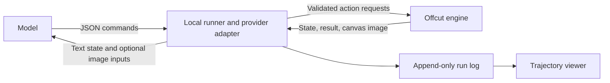

# Observation and action interfaces

Agreed scope, September 27, 2026: the first model comparison uses image-capable multimodal models, native image observations, and text/JSON action output. Models share source materials, initial canvas, observation policy, commands, and budget. Text-only assistance is deferred. The first OpenAI runner was implemented September 28; additional providers and controlled comparisons remain planned.

## What Experiment 001 actually used

The main Codex agent inspected the three source JPEGs with an image-viewing tool. After submitting action batches, it downloaded the rendered canvas from `GET /api/render.png` and inspected those PNG files through the same tool. The images arrived as image content alongside the conversation. This was direct image inspection, not screenshots of the laptop display. The image transport does not expose the model's precise internal visual tokenization or resolution handling.

Every artwork change went through JSON requests to `POST /api/actions`, submitted by a small local client. Source coordinates and placement coordinates came from the agent; the engine validated and applied them. The agent used browser automation only to confirm the finished title, canvas state, and replay controls in the app, and to keep the studio tab available. It did not click or drag artwork to create the composition.

The experiment used 48 agent actions in five batches after the owner's five initial actions. A separate agent audited the final artifacts; it did not author the artwork. The saved [trajectory](../experiments/001/trajectory.md) distinguishes the recorded action log from observations and commentary retained in the conversation.

## Implemented today

| Purpose | Interface | Contents |
| --- | --- | --- |
| Read available commands | `GET /api/help` | Action vocabulary and limits |
| Read state | `GET /api/state` | Canvas, rules, sources, pieces, transforms, layer order, budget and history; currently includes source data URLs |
| Inspect a source | `GET /api/sources/:id` | Source raster, normalized to PNG |
| Inspect canvas | `GET /api/render.png` | Clean rendering of the composition |
| Apply commands | `POST /api/actions` | One action or an atomic action batch |
| Inspect an earlier step | `GET /api/state?step=N`, `GET /api/render.png?step=N` | Reconstructed retained history without changing live state |
| Export project | `GET /api/project` | Source inventory, rules, canvas, timestamps, actions and cursor |

The action vocabulary is `cut`, `place`, `transform`, `reorder`, `remove`, and `describe`. Cuts use source-image pixel coordinates. Placement uses canvas pixels with the fragment bounding box's center as its anchor. Scale is uniform. Full details are in [AGENT_PROTOCOL.md](../AGENT_PROTOCOL.md).

For example, a model can request this existing action without using a mouse:

```json
{
  "type": "transform",
  "pieceId": "wing-upper-left",
  "x": 342,
  "y": 493,
  "rotation": 23,
  "scale": 0.96
}
```

The shared engine enforces simple source polygons, source boundaries, one-time material consumption, piece/action limits, and transform bounds. The renderer clips source images and composites them into SVG and PNG. Observation and command execution are already separate.

## Integrated experiment runner

Open `/experiments.html` for the first implementation. `lib/runs.mjs` owns isolated states, source snapshots, events and recovery; `lib/providers.mjs` translates native observations to the OpenAI Responses API. Credentials live in the backend environment or session memory. Tests inject simulated providers without paid requests.

| Interface | Purpose |
| --- | --- |
| `GET /api/providers` | Connection metadata, never credentials |
| `POST /api/providers/openai` | Set `{apiKey}` in server memory |
| `DELETE /api/providers/openai` | Forget the session override; an environment key may remain |
| `POST /api/providers/openai/test` | Check authentication through model listing, without inference |
| `GET /api/runs`, `POST /api/runs` | List runs or start a blank run from the current source inventory |
| `GET /api/runs/:id`, `/events` | Read status/specification and recorded activity |
| `GET /api/runs/:id/render.png?step=N` | Render an accepted-action replay position |
| `GET /api/runs/:id/project`, `/export` | Export portable project or full run with observation assets |
| `POST /api/runs/:id/stop` | Abort the in-flight request and stop future turns |

Run input is `{provider:"openai",model,prompt,maxTurns,maxActions,maxPieces,maxOutputTokens,maxMinutes}`. Defaults are 12 turns, 120 accepted actions, 24 fragments, 4096 output tokens per turn and 10 minutes. Caps are 40 turns, 240 actions, 64 fragments, 16384 output tokens and 60 minutes. A fixed 250000-character textual context ceiling stops the run without silently removing prior text. There is no dollar estimate or spending cap yet.

The model returns `{decision_note,actions,done}` with up to 12 actions per batch. The engine validates the entire batch atomically. Invalid JSON or actions consume a turn and return corrective feedback; the raw response and rejection remain in the log. A network error stops the run without a retry. Each turn receives all sources and the current canvas as native image attachments, resized to a 1536-pixel maximum edge, plus compact scene state and prior text. Original source coordinates remain authoritative.

`events.jsonl` is the accepted-batch commit record; project checkpoints can be reconstructed from it. Hash-addressed assets preserve original sources, observation images and canvases. Exports include the normalized request, provider adapter metadata, raw returned output, usage, errors and stop reason. Pending usage is marked incomplete. Restart reconstructs committed actions and marks unfinished runs interrupted; automatic resume is not implemented.



A runner can call a remote model while applying its commands to the local engine. There is no requirement for a model to control the desktop, run shell commands, or reach the laptop's loopback address. The adapter translates provider request/response formats; the artwork rules stay in Offcut.

Each model turn should receive compact scene state, remaining budgets, source IDs and dimensions, and the previous action results. A visual model also receives source and canvas image attachments according to a fixed observation policy. Send images as native image inputs rather than pasting base64 into textual JSON. For example, OpenAI documents image URLs and base64 data URLs as image-content inputs in its [Images and vision guide](https://developers.openai.com/api/docs/guides/images-vision). Each provider adapter must use its own supported format.

Model outputs can be tool calls or ordinary validated JSON. An optional brief `decision_note` belongs in the run log, outside artwork actions; it does not grant additional drawing abilities. The runner should retain the raw returned output and validation failures before applying accepted actions. Record model turns, observation boundaries, and action batches separately so one turn with eight actions does not look like eight independent visual decisions.

Observation images may optionally show a coordinate grid, piece IDs, or consumed source areas. These aids should never appear in the final artwork and must be fixed and recorded for comparisons. Image resizing and cropping policies also need to be explicit because coordinate precision affects performance.

## Models without image input

The action interface does not require vision. A text-only model can use the same geometry and commands if it receives a useful textual account of the material: source descriptions, spatially anchored regions, bounding boxes or polygons, colors, textures, and existing fragment relationships. Raw image bytes or base64 supplied as text do not substitute for image understanding.

This should be a separate assisted observation condition. Descriptions and segmentation select and interpret the material on the model's behalf. Preselected named fragments can also change the task by removing some cutting choices. Keep the annotation pipeline fixed, record its version and outputs, and compare those runs separately or supply the same assistance to every model in that comparison.

For the initial question—how a model inspects arbitrary visual material and invents an arrangement—the agreed first track uses multimodal models with image input. A later text-assisted track can investigate how much compositional ability survives a symbolic description of the same materials. Both can share the exact action engine.

## Playback coverage

The current studio replays accepted, retained artwork actions with a scrubber and play/pause control. It can reconstruct every action inside a batch, but it does not show which rendered state the agent actually inspected between batches. Its generic captions are descriptions of commands.

The requested richer feature is tracked in [BACKLOG.md](../BACKLOG.md). It joins observations, deliberate decision notes, attempts and errors, model metadata, and resulting artwork into an append-only trajectory. The editable project history is insufficient on its own: editing after undo truncates its abandoned continuation. The run log must preserve that activity independently.
