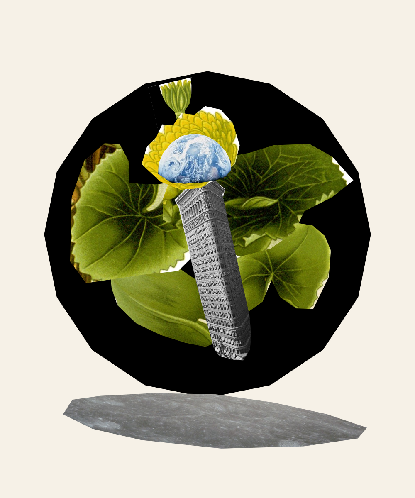

# Experiment 001 — The Migratory City

An open-ended collage made by Codex through Offcut's action API. No target image was supplied. The composition began with the owner's existing botanical fragment and five recorded actions; the agent selected the concept and continued that worktable. This is a human-seeded exploratory run, not a scored benchmark or a comparison of models.

## Artist statement

A city borrows the anatomy of a moth. Leaves become wings, Earth becomes its head, and the Flatiron becomes a body suspended above a fragment of the Moon. The creature carries its world with it: migration imagined at the scale of a civilization.

## Materials and actions

The fixed inventory contains the 1896 marsh marigold botanical plate, an archival Flatiron photograph, and NASA's Apollo 8 Earthrise photograph. Source images and their attribution are embedded in both saved projects. Original source attribution is also in `../../public/sources/CREDITS.md`.

| Measure | Result |
| --- | ---: |
| Source images | 3 |
| Final fragments | 12 of 24 allowed |
| Owner's starting actions | 5 |
| Agent actions | 48 |
| Total retained actions | 53 of 120 allowed |
| Agent cuts / placements | 11 / 11 |
| Agent transforms / layer changes | 17 / 8 |
| Title and statement actions | 1 |
| Accepted / rejected action batches | 5 / 0 |

The agent used only `/api/actions` for artwork changes. No new sources, generated imagery, painted pixels, filters, source cloning, resets, imports, undo, or redo were used during this run. Two fragments of existing black sky cover the white margins of the owner's original rectangular scrap. The paper background is the existing canvas background.

## Observable revisions

1. `01-silhouette.png`: black sky disc, architectural body, inherited antenna, and Earth head.
2. `02-wings.png`: four distinct leaf fragments become wings; black sky fragments cover the antenna's paper margins.
3. `03-refinement.png`: smaller wings, a yellow blossom behind Earth, and a lunar surface below the creature.
4. `04-flight.png`: revised layer order and a shared rotation of the creature's parts to suggest movement.
5. `05-complete.png`: final composition with title and statement saved in its project metadata.

The replay documents actions and revisions, not access to internal reasoning. Material validity and resemblance to a chosen concept do not establish a general creativity score. A meaningful comparison would require shared starting conditions, separate runs, and evaluation of the images without revealing model identity.

## Review and preservation

Open the live studio at http://127.0.0.1:4317/ and press **Replay** to watch the 53 recorded actions. Replay includes the owner's first five actions.

- `the-migratory-city.png`: final image, 1000 × 1200.
- `the-migratory-city.svg`: portable SVG with embedded source images.
- `final-project.json`: full source inventory and editable action replay.
- `starting-project.json`: preserved worktable before the agent began.
- `attempts.jsonl`: local record of all five API action batches and responses.
- `run-summary.json`: machine-readable counts and exported-image hash.
- `audit.md`: independent checks of source identity, material reuse, preserved history, and exact replay/export reproduction; all passed.

Use **Open a saved project** in Offcut to restore either project. Importing replaces the live worktable; the other saved file remains available.
