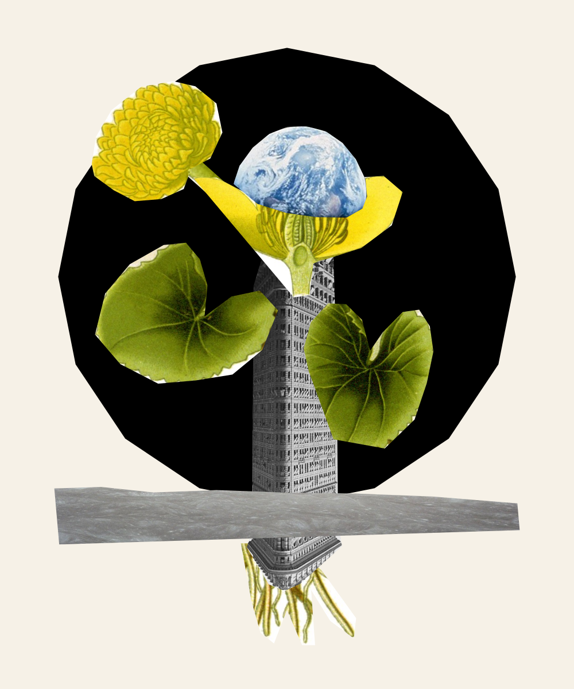

# Experiment 002 — Rootstock for a Small Planet

A fresh subagent created this collage from a blank worktable. The agent was launched with `fork_turns: "none"`: no conversation history was passed. It received only the saved neutral task prompt, a local action/observation client, and the supplied images and rules. No reference composition or theme was supplied. The parent set up the environment and audited the finished work; it did not give creative feedback or change the artwork.

## Artist statement

An inverted tower supports a flower whose seed is Earth. A lunar shelf crosses the specimen like a soil section; the fine roots below it make architecture briefly behave like something that can grow.

## Recorded result

| Measure | Result |
| --- | ---: |
| Starting actions / fragments | 0 / 0 |
| Source images | 3 |
| Final fragments | 10 of 24 allowed |
| Accepted / attempted artwork API actions | 32 / 32 |
| Accepted / rejected batches | 4 / 0 |
| Source image retrievals | 3 |
| Construction canvas retrievals | 3 |

The agent's notes also report inspection of the final exported PNG. The three logged construction renders do not include that separate final file inspection. A sandbox network failure occurred before successful environment access; it was resolved through the normal local-network permission and did not reject an artwork action.

## What the run establishes

- The starting source pixels are byte-identical to Experiment 001's inventory.
- The final source inventory, canvas, rules, and project identity match the saved initial project.
- All 32 actions replay successfully through the rule engine, including its material-overlap checks.
- The replayed actions exactly match the four recorded accepted batches.
- The final PNG and SVG match the reconstructed state exactly. Recorded observation-image hashes verify.
- The original worktable on port 4317 is unchanged. Its project was also preserved locally before this run.

This was a fresh conversation context, not a different model. No model override was supplied; the subagent inherited its parent's model configuration, and an exact provider model identifier was not captured. File isolation was instruction-based in a shared workspace; it was not a separate filesystem sandbox. The prompt prohibited reading the parent repository, earlier experiments, other agents, or conversation records.

This is an exploratory comparison. Experiment 001 started with a user-provided fragment and five actions, while this work started blank. Those differing initial conditions prevent treating the pair as a controlled test of context alone. Both works independently use a black sky disc and a city/plant combination; more runs would be needed to investigate why that pattern recurs.

## Review

- `agent-prompt.txt`: exact saved task instructions.
- `dispatch.json`: fresh-context dispatch configuration and prompt hash.
- `setup.json`: initial constraints, source hashes, and setup metadata.
- `initial-project.json`: blank starting project with the fixed source inventory.
- `final-project.json`: finished portable project with all 32 actions.
- `artwork.png` / `artwork.svg`: final exports.
- `artist-notes.md`: the artist agent's statement and account of revisions.
- `events.jsonl`: client-recorded state/image retrievals, action requests, public intent notes, responses, and exports.
- `trajectory.md`: readable action sequence with batch notes and image checkpoints.
- `run-summary.json`: counts and audit results.
- `observations/`: the actual source and construction images retrieved for inspection.
- `audit.mjs`: reproducible validation of the saved sources, requests, history, and exports.

The event log records client operations; it is not a complete model transcript, a record of hidden reasoning, or a tamper-proof server audit trail. Token use and per-model-call timing were not recorded. The parent's audit checks consistency and constraints, not creative quality.

The separate studio is at http://127.0.0.1:4318/. Press **Replay** to watch the accepted actions. Restart its local saved session with `node experiments/002/serve.mjs` from the repository root. On another computer, open `final-project.json` through the studio's **Open a saved project** control to restore the artwork.
