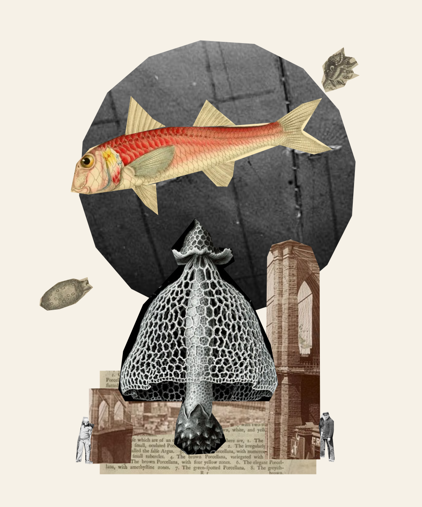

# Work A003 — The Tidal Observatory

A fresh Codex subagent made this collage from six images sampled uniformly without replacement from the local collection of 21. It started with a blank canvas, received no inherited conversation history (`fork_turns: "none"`), and chose its own subject. The parent prepared the materials and audited the result without giving creative feedback or changing the artwork.

[Open the work and playback](http://127.0.0.1:4317/work.html?run=archive-003).

## Model-authored statement

> A red mullet sails over an observatory built from fungal lace and Brooklyn Bridge masonry. An airship’s skin becomes its moon, while shell specimens drift beyond the chart. Two small figures hold the scene at human scale.

## Materials and result

The random draw selected Brooklyn Bridge, Fungi, Shells, Boarding an airship, Frederick Douglass, and Red Mullet, in that order. The artist retrieved and reported inspecting all six. It used five, leaving the Douglass portrait unused. The selection was not rerolled; candidate hashes and each draw's pool size and index are saved in `setup.json`.

| Measure | Result |
| --- | ---: |
| Starting actions / fragments | 0 / 0 |
| Supplied / used sources | 6 / 5 |
| Final fragments | 16 of 24 allowed |
| Accepted / submitted actions | 44 / 44 |
| Accepted / rejected batches | 5 / 0 |
| Source image retrievals | 6 |
| Canvas image retrievals | 5 |

Actions comprise 16 cuts, 16 placements, 10 transforms, one layer change, and one title/statement submission. Public revision notes and the rendered checkpoints are linked from [trajectory.md](trajectory.md). The artist's account is in [artist-notes.md](artist-notes.md).

The canvas was 1000 × 1200 pixels, with limits of 24 fragments and 120 accepted actions. The supplied client allowed at most 12 attempted batches of up to 12 actions each. Those batches are not model turns. No output-token or wall-clock limit was enforced. The artist finished voluntarily with budget remaining.

## Audit

`node experiments/003/audit.mjs` verifies the recorded selection and source hashes, unchanged source inventory and rules, saved prompt hash, correspondence between submitted batches and accepted history, action and batch limits, engine replay, and observation-image hashes. The saved PNG and SVG exactly match replay. At completion, the original worktable on port 4317 retained its source inventory and artwork history unchanged.

The local original-worktable backup is intentionally outside version control. On another computer, its optional preservation check may be unavailable; the artwork replay and source checks remain reproducible. Regenerate the readable sequence after auditing with `node experiments/003/record-trajectory.mjs`.

## Conditions and records

No model override was supplied and the exact provider model identifier was not captured. Fresh context means no prior conversation was passed, not a different model. Directory and API isolation were instructions in a shared workspace, not a separate filesystem sandbox. The task prohibited reading earlier experiments, repository context, other agents, or conversation records.

Source and canvas observations were PNG files retrieved through the local client and inspected with an image-viewing tool. Changes used JSON actions through that client. The event log records client operations and public intent notes; it is not a complete model transcript, private reasoning record, or tamper-proof server audit. An initial read-only connection required normal sandbox network escalation and did not consume artwork actions.

- `agent-prompt.txt`, `dispatch.json`: supplied instructions and dispatch configuration.
- `setup.json`, `initial-project.json`: draw record, constraints, and blank starting project.
- `final-project.json`, `artwork.png`, `artwork.svg`: replayable work and final exports.
- `events.jsonl`, `observations/`: logged requests, responses, state retrievals, and image checkpoints.
- `trajectory.md`, `artist-notes.md`, `run-summary.json`: readable sequence, artist account, and audited counts.
- `build.mjs`, `fish.mjs`, `refine-structure.mjs`, `details.mjs`, `finish.mjs`: scripts the artist used to submit its actions; do not rerun against the completed worktable.

The isolated worktable can resume on port 4319 with `node experiments/003/serve.mjs`. The saved project is portable; the read-only Library viewer is the preferred way to inspect its playback.
